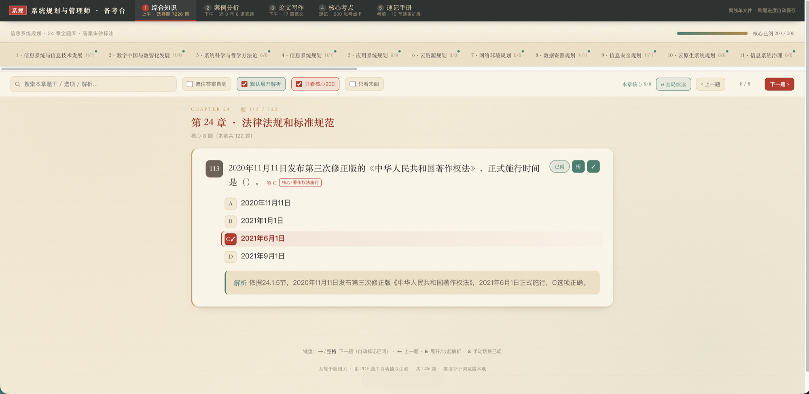

# 系规备考台

> 系统规划与管理师（软考高级）· 离线单文件刷题工作台

一个**零依赖、离线可用**的单 HTML 文件学习工具，把教材题库、历年真题、核心考点和速记手册整合进同一页面。双击即可在浏览器打开，无需安装、无需联网、无需服务器，刷题进度自动保存在浏览器本地。

## 快速开始

1. 下载仓库里的 [`系规备考台.html`](系规备考台.html)
2. 用任意现代浏览器（Chrome / Edge / Safari / Firefox）双击打开
3. 开始刷题，进度会自动保存

> 全部功能都在一个 `.html` 文件内，可随意拷贝到 U 盘、手机或平板，随时随地离线使用。

## 四大模块

| 模块 | 内容 | 说明 |
| --- | --- | --- |
| **① 综合知识** | 上午 · 选择题 7226 题 | 覆盖教材 24 章全题库，答案朱砂标注，配逐题解析 |
| **② 案例分析** | 下午 · 近 3 年真题 | 收录近年案例真题，含考试大纲、答题模板与计算公式 |
| **③ 核心考点** | 速记 · 200 张考点卡 | 高频核心考点浓缩成卡片，适合考前快速过一遍 |
| **④ 速记手册** | 考前 · 15 节逐条扩展 | 分节速记手册，支持逐节已读进度与跨节搜索 |

## 主要功能

- **遮答案自测**：勾选「遮住答案自测」隐藏正确选项与解析，先自己作答再对照
- **核心题筛选**：一键「只看核心 200」，聚焦高频必考题目
- **未阅过滤**：「只看未阅」帮你快速找到还没刷过的题
- **全文搜索**：按题干 / 选项 / 解析关键词搜索本章内容
- **全局续读**：跨章节记住上次读到的位置，一键接着刷
- **已阅标记**：翻到下一题即自动标记已阅，也可手动切换
- **进度持久化**：刷题进度、已阅状态、当前模块全部存于浏览器本地（localStorage），关闭后再打开自动恢复
- **键盘快捷键**：刷题无需鼠标

## 键盘快捷键

| 按键 | 功能 |
| --- | --- |
| `→` / `空格` | 下一题 |
| `←` | 上一题 |
| `E` | 展开 / 收起解析 |
| `S` | 手动切换「已阅」 |

## 说明

- 题库内容由 PDF 教材题库自动抽取整理生成，共 7226 题。
- 本工具为纯前端单文件，不收集、不上传任何数据，所有进度仅保存在你自己的浏览器中。
- 如清除浏览器缓存或更换设备，本地进度会重置。

## License

仅供个人学习备考使用。
